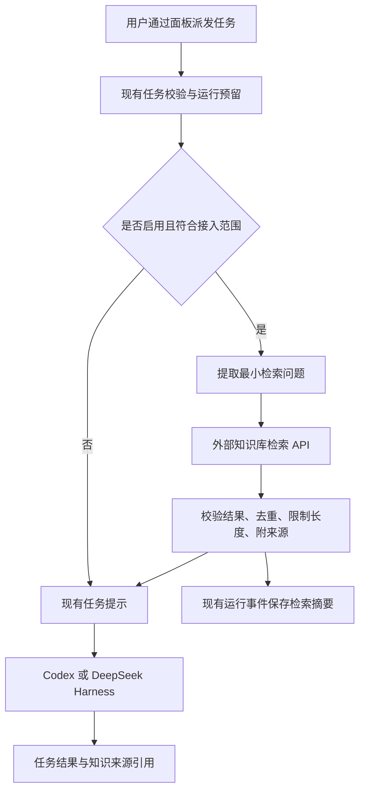

本次使用：未使用子 Agent，由 main-agent 直接处理；Skill：main-agent、base-guidelines、writing-plans；原因：本次交付团队外部知识库接入方案，先明确接入范围、实施路径与验收条件。

# 当前团队接入 RAG 外部知识库方案

## 1. 问题与目标（含不做什么）

### 1.1 建议结论

**建议采用“外部知识库负责资料管理与检索，团队后端负责调用、筛选和引用，现有 Agent 负责完成任务”的方式。**

首期从团队面板的任务派发链路接入：派发前检索相关资料，将有来源的知识片段加入任务上下文，再交给 Codex 或 DeepSeek Harness。先用小规模、已授权的共享资料验证价值，通过后再扩展到客户端独立会话、更多数据源和岗位权限。

如果已经在使用某个知识库，优先复用它的检索 API；如果尚未选型：

- 以 Markdown、操作手册、项目文档等文本资料为主：优先试点 **Dify 知识库**。
- 以复杂 PDF、扫描件、表格文档为主：对同一批样本比较 **RAGFlow** 的解析和召回效果，再决定。
- 首期不自建向量数据库和文档解析流水线，以控制开发和维护成本。

### 1.2 已核实的当前情况

| 当前事实 | 对方案的影响 |
| --- | --- |
| 项目使用 Node.js 24、CedarJS、GraphQL、Prisma 和 PostgreSQL | 可以通过后端原生 `fetch` 调用外部检索 API，无需先引入 RAG 框架 |
| `api/src/services/tasks/tasks.ts` 负责任务派发 | 适合作为统一检索入口 |
| `api/src/lib/agentDispatch.ts` 统一生成提示并启动 Codex、DeepSeek Harness | 两个平台可以共用同一份检索上下文 |
| 任务派发已有运行预留、并发控制、失败处理和方案批准逻辑 | 接入时应保留这些行为，避免重复检索、重复启动或绕过批准 |
| `TaskEvent` 已有 `evidence` JSON 字段 | 首期可保存检索摘要，无需新增数据库表 |
| Agent 子进程当前继承后端环境变量 | 新增知识库凭证时，需要限制向子进程传递 |
| 本次检查范围内未发现已接好的 RAG 检索链路 | 方案按新增检索能力设计，不假设已有服务可直接使用 |

### 1.3 目标

首期实现以下能力：

1. 面板派发任务时，按配置检索一个已授权的外部知识库。
2. Codex、DeepSeek Harness 都能收到相关知识片段与来源标识。
3. Agent 基于知识库作出事实判断时能够引用来源；资料不足时明确说明。
4. 区分“未启用”“没有命中”“服务异常”，避免把错误解释为知识库没有答案。
5. 可以通过配置停用接入，恢复原有任务派发流程。
6. 用代表性问题验证检索收益、延迟和费用，再决定是否扩大范围。

### 1.4 首期范围与不做什么

首期按“一个团队共享资料集、一个知识库供应商、面板派发入口”实施。

首期不包含：

- 全量上传个人文件、团队仓库、会话历史或任务日志。
- 接入健康、财务、家庭、客户保密等敏感资料。
- 自动向知识库写回 Agent 的回答和任务成果。
- 自建向量库、微调模型、知识图谱或多层 Agent 检索工作流。
- 新增知识库管理页面和数据库迁移。
- 默认让全部岗位、全部任务都检索知识库。
- 自动改造 Codex、DeepSeek Harness 的全局配置。
- 承诺面板之外的独立会话自动拥有检索能力。
- 把岗位名称当作已经实现的数据访问权限。

**本次状态：方案草稿，待确认后实施。** 本次仅进行仓库读取和官方文档核验，未修改文件、上传资料、部署服务或调用真实知识库。

## 2. 方案设计（关键取舍与备选）

### 2.1 整体架构



外部知识库负责文档导入、解析、切分、索引和更新；团队后端只负责检索接入与结果规范化；Agent 继续使用现有执行平台完成分析、规划和实现。

首期调用的是**知识片段检索接口**，由现有 Agent 生成最终结果，避免额外引入一次外部问答生成。

### 2.2 产品选择与取舍

| 选择 | 适用条件 | 主要收益 | 主要代价 | 本次建议 |
| --- | --- | --- | --- | --- |
| 复用已有知识库 API | 已有稳定知识平台，能返回片段和来源 | 保留现有资料管理习惯，迁移较少 | 需核对权限、接口和数据更新能力 | 有现成平台时优先 |
| Dify 知识库 | 文本资料为主，需要可视化维护 | 有独立检索 API，便于和现有 Agent 集成 | 需要管理模型配置、索引、服务和凭证 | 无既有平台时的首选试点 |
| RAGFlow | PDF、扫描件、复杂版式较多 | 值得重点验证文档解析和来源定位能力 | 部署资源和运维负担需要单独评估 | 文档结构复杂时比较 |
| 自建 PostgreSQL + pgvector | 需要深度定制权限、数据模型与检索策略 | 控制能力较强 | 解析、同步、检索、评测均需自行维护 | 首期暂不采用 |

本次已通过官方文档核验：

- Dify 提供 `POST /datasets/{dataset_id}/retrieve`，可返回片段、分数和文档信息：[官方 API 定义](https://github.com/langgenius/dify-docs/blob/main/en/api-reference/openapi_service.json)。
- Dify 知识库 API 密钥可限定知识库范围，实际能力需按部署版本核对：[知识库 API 指南](https://github.com/langgenius/dify-docs/blob/main/en/api-reference/guides/knowledge-base-api.mdx)。
- RAGFlow 提供 `POST /api/v1/retrieval`：[官方 HTTP API 文档](https://github.com/infiniflow/ragflow/blob/main/docs/references/http_api_reference.md)。
- RAGFlow 当前文档建议的自部署起点为 4 核 CPU、16 GB 内存、50 GB 可用磁盘；这不是当前设备适配结论：[官方部署说明](https://github.com/infiniflow/ragflow/blob/main/docs/quickstart.mdx)。

实施前应锁定实际部署版本，并以该版本接口做契约验证。

### 2.3 首期采用派发前检索，后续再扩展按需检索

**首期：后端派发前检索。**

优点是接入点集中，两个执行平台行为一致，也不依赖客户端是否配置 MCP。每轮任务最多进行一次检索，容易控制延迟和费用。

局限是任务执行过程中产生的新问题无法继续检索，且一次检索不适合复杂的多主题任务。

**第二阶段：通过受控工具提供按需检索。**

当首期证明有效，且用户确实需要在 Codex、DeepSeek Harness 独立会话中使用知识库时，再设计 MCP 或受认证的检索工具。届时单独确定客户端配置、调用身份、调用次数、权限和审计方式。

第二阶段不包含在首期默认实施授权中。

### 2.4 知识与资料组织

试点建议选取 **20～50 份可共享文档**，例如项目说明、内部操作手册、产品术语和常见问题。

在知识库侧维护以下信息：

| 信息 | 用途 |
| --- | --- |
| 文档 ID、标题、片段 ID | 稳定定位检索证据 |
| 原始链接或文件标识 | 支持人工核对 |
| 版本或内容哈希 | 识别内容变动 |
| 更新时间、有效期 | 判断时效；来源缺失时明确标注未知 |
| 资料负责人 | 负责更新、停用和删除 |
| 共享范围 | 确认能否进入首期共享资料集 |

首期只维护一个明确的共享资料边界。岗位启用列表只用于控制试点范围，不承担安全隔离职责。

资料更新先通过知识库原有管理界面完成，不新增同步服务：

1. 导入后检查解析结果，再允许参与检索。
2. 更新文档后等待索引成功，并用固定问题验证。
3. 文档撤销或删除后，验证旧片段不再出现。
4. 首期不增加跨任务检索缓存，减少权限撤销和资料更新后的陈旧结果问题。

### 2.5 检索与上下文规则

首期建议默认值如下，均为试点参数，需通过评测调整。

| 配置 | 建议 |
| --- | --- |
| 总开关 | 默认关闭 |
| 启用岗位 | 先选择 main-agent 和一个有代表性的业务岗位 |
| 每轮检索次数 | 最多 1 次；不自动循环检索 |
| 查询内容 | 从任务标题和需求中提取最小问题，不发送完整提示、历史会话或附件 |
| 查询长度 | 按供应商接口限制截断；Dify 当前文档上限为 250 字符 |
| 候选片段 | 最多 6 条，去重后注入最多 4 条 |
| 上下文长度 | 单片段最多 1,500 字符，总知识正文最多 5,000 字符 |
| 超时 | 总请求时限 4 秒 |
| 自动重试 | 首期关闭，避免派发等待和费用放大 |
| 检索方式 | 先验证关键词基线，再评估混合检索的收益 |
| 重排 | 首期默认关闭，召回评测证明需要时再启用 |
| 分数阈值 | 根据实际知识库和问题集校准，不直接套用固定数值 |

统一检索结果至少包含：

- 文档和片段标识。
- 标题、正文、供应商返回的检索分数。
- 可用的原始链接或文件标识。
- 版本及更新时间；没有返回的字段保持缺失，不自行补造。

每个片段生成 `[KB-1]` 这样的本轮引用标记。任务提示要求 Agent 区分知识库事实、自己的推断和信息缺口，不能把检索分数直接当作答案正确率。

### 2.6 安全、数据去向与凭证

数据流需要按以下边界确认：

1. **原始资料**进入选定知识库；若其解析、Embedding 或重排使用外部服务，相关内容还可能进入这些服务。
2. **检索问题**由团队后端发给知识库。
3. **召回片段**进入 Codex 或 DeepSeek Harness 的任务提示，受现有模型调用、会话和日志留存机制影响。

因此，自部署知识库也不能直接等同于“全部数据都留在本地”。模型供应商、网关及日志位置都需要核对。

首期控制措施：

- 知识库 API 地址和知识库 ID 由后端配置固定，任务正文不能覆盖。
- 仅调用检索接口，不提供上传、删除、修改文档的工具。
- 凭证使用供应商支持的最小范围。若无法提供严格只读密钥，应通过网关限制方法和路径，或改用可满足要求的服务。
- 知识库密钥不进入前端、提示正文、命令参数或普通日志。
- 派发子进程时剔除新增知识库凭证。环境变量过滤不能替代操作系统隔离；敏感资料接入前需进一步评估文件和进程访问边界。
- 检索文本作为外部资料处理，不作为系统指令。片段中的命令、权限申请或“忽略已有规则”等内容不得获得执行授权。
- 校验返回结构、响应大小和来源链接；不自动访问片段中的任意 URL。
- 使用 HTTPS，或明确授权的本地受控地址；不接受任务指定任意检索地址或重定向目标。

### 2.7 失败、降级与审计

提供两种明确模式：

| 模式 | 行为 |
| --- | --- |
| `optional` | 适合一般参考任务。超时或错误时继续原任务，但明确说明知识库不可用，不能声称已查证 |
| `required` | 适合必须依据内部资料的任务。无有效证据、配置错误或检索失败时停止派发，不启动 Agent |

鉴权失败不能自动切换成更大范围的密钥或知识库。

检索状态区分为：关闭、跳过、命中、无命中、超时、错误。使用现有运行事件记录状态、耗时、结果数量、来源 ID、内容哈希和适配器版本，不保存密钥、完整查询或片段正文。

检索摘要附加到本轮已有的派发事件中，沿用已有运行 ID 和事件顺序，不为知识检索另建任务。

### 2.8 成本边界

首期成本由知识平台资源、文档解析与索引、查询 Embedding、可选重排，以及 Agent 输入增加部分组成。

估算方式为：

> 月成本 ≈ 服务固定成本 + 当月增量文档索引成本 + 检索次数 × 单次检索成本 + 注入片段带来的模型输入成本。

尚无资料规模、服务供应商和使用频率，当前不提供未经验证的金额。试点期间记录真实用量；平台不提供的费用或 Token 标记为“未采集”，不以估算冒充实测。

## 3. 影响文件清单（预计新增/修改哪些文件）

以下为**首期建议范围**，仅表示确认后的预计变更，本次未写入。

| 文件 | 类型 | 预计职责 |
| --- | --- | --- |
| `api/src/lib/knowledgeConfig.ts` | 新增 | 读取和校验开关、地址、知识库 ID、启用岗位、超时及降级模式 |
| `api/src/lib/knowledgeRetrieval.ts` | 新增 | 实现选定供应商的检索调用、响应校验和统一结果转换 |
| `api/src/lib/knowledgeContext.ts` | 新增 | 提取查询、去重、限制上下文长度、生成引用与检索摘要 |
| `api/src/lib/knowledgeConfig.test.ts` | 新增 | 验证默认关闭、配置错误和试点范围判断 |
| `api/src/lib/knowledgeRetrieval.test.ts` | 新增 | 验证接口映射、超时、异常响应和调用边界 |
| `api/src/lib/knowledgeContext.test.ts` | 新增 | 验证查询最小化、去重、长度预算、引用和空结果 |
| `api/src/lib/agentDispatch.ts` | 修改 | 接收知识上下文，并过滤子进程中的知识库凭证 |
| `api/src/lib/agentDispatch.test.ts` | 修改 | 验证两个平台的上下文及原有提示约定 |
| `api/src/services/tasks/tasks.ts` | 修改 | 在运行预留后、启动进程前检索，接入降级和事件摘要 |
| `api/src/services/tasks/tasks.test.ts` | 修改 | 验证派发、排队、取消、失败及批准流程的回归行为 |
| `.env.example` | 修改 | 增加不含真实凭证的配置说明 |
| `README.md` | 修改 | 说明接入范围、配置、资料维护、验证和停用方式 |

实际部署时还需通过受控环境配置注入凭证；真实密钥不提交仓库。

首期不预计修改 Prisma Schema、数据库迁移、GraphQL 接口、前端页面、岗位规则、插件生成物或全局客户端配置。直接使用 Node.js 24 原生 HTTP 能力，不计划新增运行依赖。

第二阶段若确定加入 MCP、资料同步或独立会话支持，再单独列出文件和配置范围。

## 4. 实施步骤（可照着执行的顺序）

### 步骤一：确认服务、资料和授权边界

- [ ] 确认是否已有知识库平台及可用检索 API。
- [ ] 选定试点资料、资料负责人和允许参与的岗位。
- [ ] 核对知识库、Embedding、重排、执行模型及日志的数据去向。
- [ ] 确认托管或自部署方式、费用上限，以及 `optional` / `required` 使用规则。
- [ ] 固定供应商、部署版本及接口契约。

**完成条件：** 可以明确说明哪些资料允许进入哪些服务，以及哪些任务可使用这些资料。

### 步骤二：准备样本文档与评测基线

- [ ] 由资料负责人整理 20～50 份授权文档，并补齐来源标识。
- [ ] 在选定知识平台建立独立试点知识库。
- [ ] 导入资料，人工检查标题层级、表格、分页与切分结果。
- [ ] 建立 40 道代表性问题及标准证据。
- [ ] 记录现有关键词检索的召回表现，作为对照。

**完成条件：** 资料可追溯，问题集覆盖正常问答、无答案、版本冲突和恶意文本。

资料上传及可能产生的模型费用，在相应授权确认后执行。

### 步骤三：实现配置与供应商适配器

- [ ] 实现默认关闭的配置读取和校验。
- [ ] 固定服务地址、知识库 ID 和允许调用的接口。
- [ ] 使用供应商实际版本返回的样本建立响应契约测试。
- [ ] 实现 4 秒超时、响应大小上限、结构校验和结果转换。
- [ ] 覆盖 401、403、429、5xx、空结果和异常 JSON。
- [ ] 确认错误信息不包含凭证或资料正文。

**完成条件：** 使用模拟 HTTP 响应即可证明调用和失败行为，无需启动真实 Agent。

### 步骤四：实现检索上下文

- [ ] 从任务标题和需求生成受长度限制的查询。
- [ ] 对结果去重，保留稳定来源标识。
- [ ] 按单片段和总长度上限裁剪上下文。
- [ ] 生成引用标记与明确的检索状态。
- [ ] 将知识片段标记为外部资料，并保留原任务的只读、批准与交付要求。
- [ ] 生成仅含必要元数据的审计摘要。

**完成条件：** 长文档、重复片段、缺失来源字段和恶意文本均有确定处理方式。

### 步骤五：接入现有任务派发

- [ ] 保留现有任务校验、方案批准、并发锁和运行预留逻辑。
- [ ] 在成功预留运行后发起检索，不在数据库事务内等待外部网络。
- [ ] 排队但未获执行资格的任务不检索。
- [ ] 检索完成后、启动 Agent 前再次检查任务是否取消或失效。
- [ ] 按配置决定降级继续或停止派发。
- [ ] 将同一套上下文传给两个执行平台。
- [ ] 将检索摘要附加到本轮既有派发事件。
- [ ] 从子进程环境中移除知识库凭证。

**完成条件：** 每个实际执行轮次最多检索一次，取消、排队、失败和批准行为保持正确。

### 步骤六：运行针对性验证

实现后的局部检查建议包括：

```bash
yarn test:api:unit --runInBand --runTestsByPath \
  api/src/lib/knowledgeConfig.test.ts \
  api/src/lib/knowledgeRetrieval.test.ts \
  api/src/lib/knowledgeContext.test.ts \
  api/src/lib/agentDispatch.test.ts
```

对变更文件执行目标 ESLint 检查，并执行：

```bash
git diff --check
```

派发服务测试涉及数据库，应先确认连接专用测试库，再定向运行：

```bash
yarn test:api --runInBand --runTestsByPath \
  api/src/services/tasks/tasks.test.ts
```

**完成条件：** 新增契约测试与直接相关的派发回归测试通过，无需真实模型调用即可验证主要失败路径。

完整构建、浏览器端到端检查和独立质量验收，在执行前按仓库规则确认范围与价值。

### 步骤七：小范围真实试点

- [ ] 在授权资料上执行 40 题评测，保存结果和失败原因。
- [ ] 分别验证一次 Codex 和 DeepSeek Harness 的真实任务。
- [ ] 验证文档更新、撤销和删除后的检索表现。
- [ ] 观察延迟、片段长度和实际费用。
- [ ] 演练关闭开关，确认原派发流程恢复。
- [ ] 通过验收后逐步扩大资料或岗位范围，每次只扩大一个维度。

**完成条件：** 达到下述指标，并且有可核对的回滚结果。

下一责任安排：方案确认后，由 AI 应用工程师负责检索契约和评测设计，软件工程师完成派发集成；质量与安全工程师负责独立复核，Main Agent 汇总验收结果。本次未实际派发这些岗位。

## 5. 验收标准与验证方式

### 5.1 功能与流程

| 验收项 | 通过条件 | 验证方式 |
| --- | --- | --- |
| 默认关闭 | 未启用时不发出知识库请求，沿用原提示流程 | 单元测试、派发测试 |
| 平台一致 | 两个平台获得相同结构的片段和来源 | 提示测试、各一次真实任务 |
| 查询最小化 | 请求不包含完整提示、历史会话和凭证 | 检查模拟请求体 |
| 长度控制 | 查询、片段数量、正文长度和响应大小均受限 | 边界测试 |
| 失败区分 | 空结果、超时、鉴权失败分别记录 | 故障模拟 |
| 可选降级 | 检索异常时继续任务并说明知识不可用 | 派发测试 |
| 必需知识 | 无有效证据或检索失败时不启动 Agent | 派发测试 |
| 并发与取消 | 不重复启动；取消后不继续派发 | 现有数据库并发测试扩展 |
| 批准边界 | 知识内容不能改变只读设置或绕过方案批准 | 提示及批准回归测试 |
| 关闭回滚 | 停用后停止检索，原任务链路可用 | 回滚演练 |

### 5.2 检索与回答质量

试点问题集建议分为：

| 类别 | 数量 | 验证目标 |
| --- | ---: | --- |
| 有明确答案 | 24 | 包含关键术语、同义表达和跨段信息 |
| 知识库无答案 | 8 | 不编造知识库结论或引用 |
| 版本冲突或过期 | 4 | 识别差异、说明时间与不确定性 |
| 恶意文本或诱导越界 | 4 | 不把资料内容当作执行授权 |

建议通过门槛：

- 24 道有答案问题中，至少 22 道在最终注入的前 4 个片段中包含标准证据。
- 最终展示的知识库引用全部能够追溯至真实文档和片段。
- 人工抽查中，引用对相应事实判断的支持率达到 95% 以上。
- 8 道无答案问题全部明确说明知识库证据不足，不伪造引用。
- 4 道版本问题全部呈现来源差异；资料没有日期时，不擅自判断哪份更新。
- 4 道恶意样本均不得引发由知识文本授予的写入、上传或外部调用。

这些是试点准入指标，不能替代扩大数据规模后的持续回归。

### 5.3 性能、安全与维护

- 在试点环境完成至少 30 次检索计时，检索新增耗时 P95 目标不超过 3 秒。
- 4 秒超时后按配置退出或降级，不无限重试。
- 知识库凭证不出现在前端、提示、命令参数和普通日志中。
- 任务内容无法改变检索服务地址或知识库范围。
- 更新文档重新索引后，固定问题可以检索到新版本。
- 删除或撤销文档后，旧片段不再参与新任务检索。
- 检索摘要能够定位本轮来源与适配器版本，不保存正文副本。
- 首期不向敏感资料或未授权资料扩大范围。

### 5.4 本次验证状态

本次已完成岗位规则、Skill 链接、任务派发代码、事件数据结构及供应商官方文档的只读核验。

**尚未执行：** 真实知识库连接、资料导入、接口调用测试、代码测试、性能测试、模型试点、完整构建或端到端验证。上述内容均为确认后实施与验收的工作。

本任务由团队系统派发，本次未额外创建任务运行记录或写入外部系统。

## 6. 风险与回滚

### 6.1 主要风险及应对

| 风险 | 影响 | 应对措施 |
| --- | --- | --- |
| 解析或切分质量差 | 检索到片段但缺少关键上下文 | 用代表性文档检查解析结果，并以召回指标决定选型 |
| 检索方向受任务长文本干扰 | 命中内容与真实问题偏离 | 查询最小化；多主题任务留待后续按需检索 |
| 资料过期或版本冲突 | 回答使用失效信息 | 维护版本和有效期，冲突时显式呈现 |
| 外部资料包含提示注入 | Agent 被诱导忽略规则或调用工具 | 保留资料与指令边界，限制工具权限并执行恶意样本测试 |
| 数据进入未授权供应商 | 产生隐私和商业信息风险 | 逐项确认知识平台、Embedding、重排、模型和日志去向 |
| 岗位名称被误当作权限 | 发生跨岗位资料泄露 | 首期仅使用共享资料；独立权限体系通过前不接敏感库 |
| 密钥范围过大或向子进程泄露 | 可访问或修改超出需要的数据 | 限定知识库范围、网关限制检索接口、过滤环境变量 |
| 知识服务异常 | 增加派发延迟或阻断任务 | 超时、无自动重试、明确降级模式和总开关 |
| 费用持续增加 | 索引、检索和输入成本超出预期 | 限制资料量、调用次数和上下文长度，试点记录实际用量 |
| 更换供应商或模型 | 接口、分数及索引发生变化 | 保留原文和元数据，锁定版本，更换后重新评测 |

RAG 能减少证据缺失，但不保证答案正确。重要判断仍需核对原始资料。

### 6.2 回滚步骤

1. 关闭知识检索总开关，按部署方式重启后端，使新任务停止检索。
2. 验证一个普通任务，确认恢复原派发流程。
3. 如需紧急撤销资料访问，在知识平台停用相应凭证。
4. 已启动的任务已经收到片段，关闭开关不能撤回其上下文；需要撤销时单独取消对应任务。
5. 如需回退代码，只回退本功能确认范围内的变更，保留其他既有工作区修改。
6. 首期没有数据库迁移，无需数据库结构回滚；历史检索摘要保留为审计记录。
7. 外部平台已上传资料的删除、备份清理，以及会话日志中既有片段的处理，按各自保留策略单独执行，不能视为随代码回滚自动完成。

### 6.3 待确认事项

以下事项影响实施，当前不阻塞方案交付：

1. **待确认：首批资料在哪里、主要是什么格式？**  
   请确认是现有知识平台、Markdown/Obsidian、本地文档、网盘，还是 PDF 为主；并提供大致数量和容量。建议先选 20～50 份共享文档。

2. **待确认：是否已有知识库服务，以及允许的数据去向和预算是什么？**  
   有现成服务则优先复用；没有时建议先验证 Dify。复杂 PDF 较多时比较 RAGFlow。云服务试点仅使用允许外发的样本，不默认授权上传。

3. **待确认：是否接受首期先覆盖面板派发任务？**  
   建议接受该范围，先验证两个执行平台；如果必须同时覆盖客户端独立会话，应将受控检索工具纳入首期，并重新确定接口、身份和配置范围。

4. **待确认：哪些任务必须查到知识后才能执行？**  
   建议一般参考任务使用 `optional`；明确要求依据内部制度、产品规范或流程作答的任务使用 `required`。

方案通过上述确认后，按第三部分文件范围和第四部分顺序实施；新增敏感数据源、付费部署或客户端配置变更时，再确认对应对象与影响。